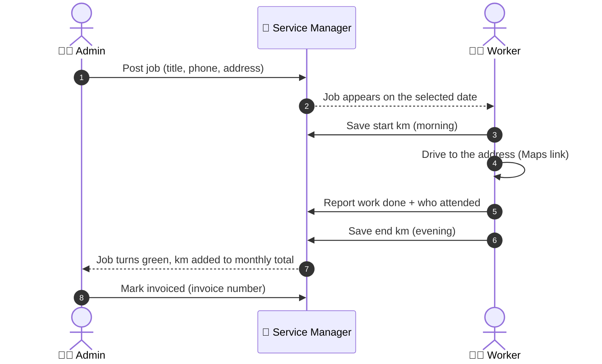
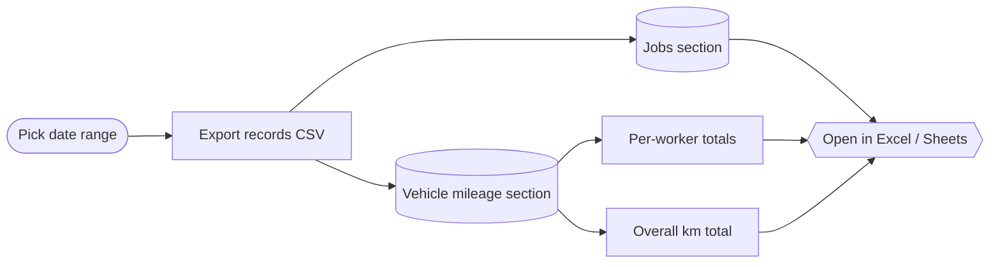
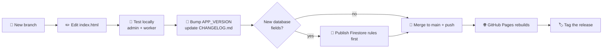

<div align="center">


<br>


**Post jobs. Track the work. Log the kilometres. Invoice. Export.**

</div>

---

## ✨ What is it?

Service Manager is a lightweight web app for a field-service team. The **admin** posts jobs for each day, **workers** report the work they did from their phones, and everything ends up in a clean month-end report, including how many kilometres the company vehicle ran.

No build step, no server. It is one `index.html` talking to Firebase.

| | Admin | Worker |
|---|:---:|:---:|
| Post jobs (title, phone, **address required**) | ✅ | |
| See today's jobs with tap-to-call and tap-to-navigate address | ✅ | ✅ |
| Report work done and who attended | | ✅ |
| Edit / delete jobs, change status | ✅ | |
| Mark jobs as invoiced (invoice number) | ✅ | |
| Enter daily **start km / end km** | ✅ | ✅ |
| See monthly kilometres | all workers + per worker | own total |
| Add or disable team members | ✅ | |
| Export CSV report | ✅ | |
| Daily progress meter (red → orange → green) | ✅ | ✅ |

---

## 🔄 The workflow

<div align="center">
  
</div>

### Day to day



### Month end



---

## 🚗 Vehicle mileage

Found at the **bottom of the page**.

1. Pick the date at the top.
2. Type the odometer **start km** in the morning and save.
3. Type the **end km** when the day is done and save again.
4. The app shows that day's kilometres, the **month total**, and a **day-by-day running total**.

Admins see every worker's entries, a per-worker total, and the combined total. The month follows the selected date, so past months are one date-change away.

---

## 🧰 Tech stack

| Layer | What |
|---|---|
| Front end | Plain HTML, CSS and JavaScript (ES modules) in `index.html` |
| Auth | Firebase Authentication (email + password) |
| Database | Cloud Firestore (real-time listeners) |
| Hosting | GitHub Pages |

---

## 🗂️ Project structure

```
.
├── index.html        # the whole app
├── logo.png          # logo used in the header and login screen
├── firestore.rules   # database security rules (keep in sync with Firebase)
├── CHANGELOG.md      # what changed in each version
├── README.md         # you are here
└── assets/
    ├── banner.svg    # animated header
    └── workflow.svg  # animated workflow
```

---

## 🚀 Setup

### 1. Firebase

1. Create a project in the [Firebase console](https://console.firebase.google.com/).
2. Turn on **Authentication → Email/Password**.
3. Create a **Firestore database**.
4. Register a web app and copy its config into the `firebaseConfig` object in `index.html`.
5. Under **Authentication → Settings → Authorized domains**, make sure `<your-username>.github.io` is listed.

### 2. First admin

The very first admin has to be created by hand:

1. **Authentication → Users → Add user** (email + password). Copy the new user's **UID**.
2. In Firestore, create a document `users/<that UID>` with:

```json
{ "name": "Your Name", "email": "you@company.com", "role": "admin", "active": true }
```

After that, add workers from inside the app (**Team members → Add worker**).

### 3. Security rules

Publish rules for the `users`, `tasks` and `mileage` collections. The full file is [`firestore.rules`](firestore.rules). The mileage part (it uses the `isAdmin()` / `isStaff()` helpers defined at the top of that file):

```
match /mileage/{id} {
  allow read: if isAdmin() || (isStaff() && resource.data.uid == request.auth.uid);
  allow create, update: if isStaff()
      && request.resource.data.uid == request.auth.uid
      && id == request.auth.uid + '_' + request.resource.data.date;
  allow delete: if false;
}
```

> 🔐 The Firebase config in `index.html` is a public web key, so it is fine in a repo. **Your Firestore rules are what protect the data.** Check them before making the repo public.

### 4. GitHub Pages

**Settings → Pages → Deploy from a branch → `main` / root.** Every push to `main` goes live in a minute or two.

---

## 🗃️ Data model

<details>
<summary><b>Click to expand the Firestore collections</b></summary>

<br>

**`users/{uid}`**

| Field | Meaning |
|---|---|
| `name`, `email` | who they are |
| `role` | `admin` or `worker` |
| `active` | `false` blocks login access |

**`tasks/{auto id}`**, one per job

| Field | Meaning |
|---|---|
| `date` | `YYYY-MM-DD` the job is posted for |
| `title`, `phone`, `address`, `notes` | job details (address is required) |
| `status` | `pending` or `done` |
| `workDone`, `attendedBy` | the worker's report |
| `completedAt`, `completedBy`, `completedByName` | who finished it and when |
| `invoiced`, `invoiceNo`, `invoicedAt`, `invoicedBy` | invoice tracking |
| `createdAt`, `createdBy`, `expireAt` | housekeeping (`expireAt` is only used if you enable Firestore TTL) |

**`mileage/{uid}_{YYYY-MM-DD}`**, one per worker per day

| Field | Meaning |
|---|---|
| `uid`, `name` | the worker |
| `date`, `month` | the day, and `YYYY-MM` for monthly totals |
| `startKm`, `endKm` | odometer readings (`endKm` can be empty until the evening) |
| `km` | `endKm - startKm`, calculated on save |
| `updatedAt` | last save |

</details>

---

## 🏷️ Versioning and releases

Versions follow a simple pattern: **1.8 → 1.9** for new features, **1.8.1** for small fixes, **2.0** for big changes. The current version is set in one place:

```js
const APP_VERSION = '1.8';   // inside index.html
```

It shows on the login screen and in the footer.



**Test locally** (don't just double-click the file, because Firebase login can fail from a `file://` address):

```bash
python -m http.server 8000
# then open http://localhost:8000
```

**Tag a release:**

```bash
git tag -a v1.8 -m "Version 1.8"
git push origin v1.8
```

**Roll back a bad release:**

```bash
git revert HEAD
git push
```

See [`CHANGELOG.md`](CHANGELOG.md) for the full history.

---

## 🩺 Troubleshooting

| Problem | Likely cause |
|---|---|
| "Missing or insufficient permissions" on mileage | `mileage` rules not published, or the rule uses a variable name (like `$(database)`) that doesn't match your `match /databases/{...}` line |
| Login fails on the live site | `<username>.github.io` missing from Firebase authorized domains |
| Old version still showing | Wait a minute, then hard refresh with **Ctrl + Shift + R** |
| Old job asks for an address when editing | Expected. Jobs posted before 1.8 have no address yet |

---

<div align="center">

© Pentech Technologies. All rights reserved.
Designed and Developed by Sankha Mudhitha

<sub>Service Manager · v1.8</sub>

</div>
