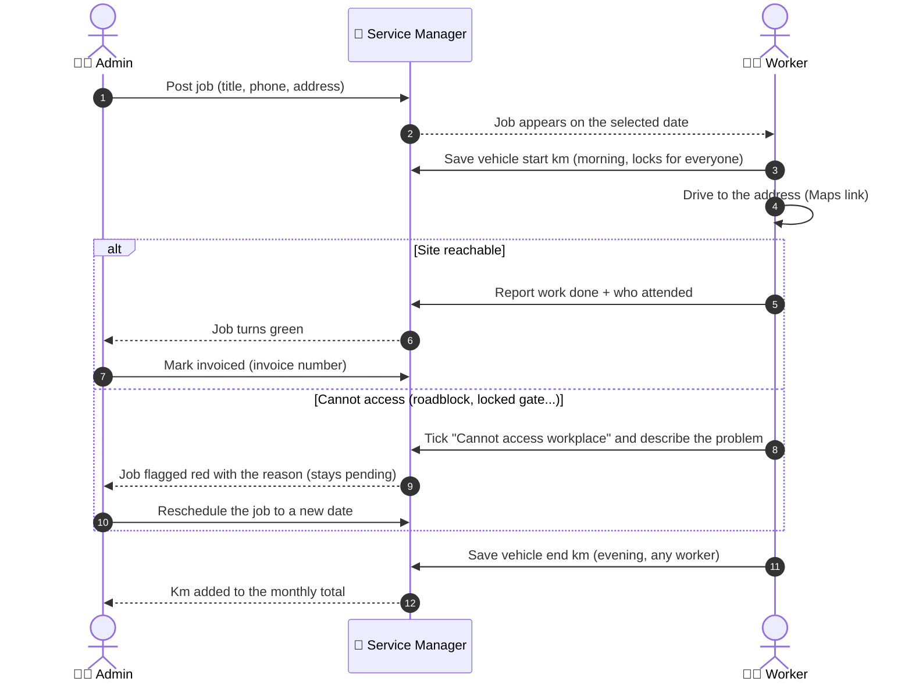
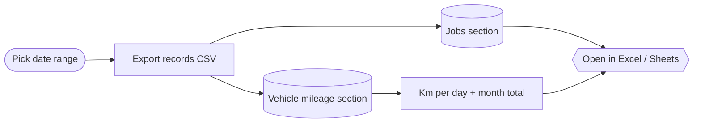
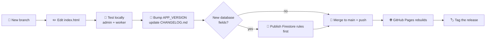

<div align="center">



<br>


**Post jobs. Track the work. Log the kilometres. Invoice. Export.**

</div>

---

## ✨ What is it?

Pentech CCTV Service Manager is a lightweight web app for a field-service team. The **admin** posts jobs for each day, **workers** report the work they did from their phones, and everything ends up in a clean month-end report, including how many kilometres the company vehicle ran.

No build step, no server. It is one `index.html` talking to Firebase.

| | Admin | Worker |
|---|:---:|:---:|
| Post jobs (title, phone, **address required**) with a "job successfully created" confirmation | ✅ | |
| **Assign workers** to a job (when posting or editing) | ✅ | see who is assigned |
| See today's jobs with tap-to-call and tap-to-navigate address | ✅ | ✅ |
| Report work done and who attended | | ✅ |
| Unfinished jobs **carry over** to the next day and stay on top until done | ✅ | ✅ |
| Flag a job as **cannot access workplace** (roadblock, locked gate…) with the reason | edit / clear | ✅ |
| Edit / delete jobs, change status | ✅ | |
| **Reschedule** a job (including "cannot access" jobs) to a new date | ✅ | |
| **Calendar**: pick a day to see the jobs posted and completed | ✅ | ✅ |
| **Non invoiced jobs** list (completed, no invoice yet) | ✅ | |
| Mark jobs as invoiced (invoice number) | ✅ | |
| Enter the vehicle's **start km** (morning) / **end km** (evening), **today only** | correct any day | ✅ |
| See kilometres driven this month | ✅ | ✅ |
| Add or disable team members | ✅ | |
| Export CSV report | ✅ | |
| Daily progress meter (red → orange → green) | ✅ | ✅ |

---

## 🔄 The workflow

<div align="center">
  
</div>

### Day to day



### Month end



---

## 🔁 Unfinished jobs carry over

A job that is not done does not disappear at midnight.

- On **today** (or any later date) the app shows the day's jobs **plus every job still pending from earlier days**, marked **↪ From <date>**.
- Carried-over jobs are **always at the top**, oldest first, until someone completes them.
- When a carried-over job is completed, it stays visible that day as done.
- **Past dates** show only the jobs posted for that date, so history stays clean.
- The job keeps its **original date**, so the CSV report still lists it under the day it was posted.

---

## ⛔ Cannot access the workplace

Roadblock? Locked gate? Nobody home? On the job's **report** screen the worker ticks **Cannot access workplace**. A box opens for **what happened**, and the "what was done" box is replaced.

- The job stays **pending**, so it never counts as completed or ready to invoice.
- It gets a red **⛔ Cannot access** badge with the reason, who reported it and when.
- **Admin** sees these jobs at the top of the list, and the daily summary counts them.
- When the site becomes reachable, the worker opens the job again (**Update report**), unticks the box and reports the work as usual.

---

## 📅 Rescheduling jobs

When a job cannot be done on its day (a **Cannot access** report, a customer request, bad weather), the admin taps **📅 Reschedule** on the job.

- Choose the **new date** and, if you like, add a reason.
- The job moves to that date, stays **pending**, and the "cannot access" flag is cleared so the worker can report it again.
- The card shows **📅 Rescheduled from <date>** with who did it and why.
- The button is highlighted on cannot-access jobs and also available on any other pending job.

---

## 🗓️ Calendar

Beside the job list on wide screens, and a collapsible **📅 Calendar** panel at the top on phones. Available to admin and workers.

- Dots on each day: **orange** pending, **red** cannot access, **green** completed that day.
- Tap a day to open it in the main list. The panel under the calendar lists the jobs **posted** that day and the jobs **completed** that day (including jobs carried over from earlier days).
- Use ‹ and › to move between months.

---

## 👷 Assigning workers

The admin can tick the team members for each job when **posting** it, or later from **Edit**. Assigned names show on the job card and in the calendar. Workers see an **Assigned to you** badge, and their report form starts with the assigned workers ticked under *Who attended* (they can change it).

---

## 🧾 Non invoiced jobs

An admin-only section, next to *Add jobs* and *Team members*, listing every **completed job that has no invoice yet**, across all dates, oldest first, with how many days it has been waiting. Tap **Mark invoiced**, enter the invoice number, and the job leaves the list straight away. If you later remove an invoice mark, the job comes back.

---

## 🚗 Vehicle mileage

Found at the **bottom of the page**. The team shares one company vehicle, so there is **one record per day**.

1. **Morning:** any worker types the odometer **start km** and taps **Save start km**. It is then **greyed out and locked for everyone**, with the name of who saved it.
2. **Evening:** the **end km** box opens. Any worker types it and taps **Save end km**. It can't be lower than the start km, and once saved the day is complete.
3. Start and end can never be saved together, and workers can only enter **today's** mileage, whatever date is selected at the top.
4. Everyone sees the **kilometres driven this month** and a day-by-day running total.

The admin can pick any date to look at past months or correct a wrong reading.

---

## 🧰 Tech stack

| Layer | What |
|---|---|
| Front end | Plain HTML, CSS and JavaScript (ES modules) in `index.html` |
| Auth | Firebase Authentication (email + password) |
| Database | Cloud Firestore (real-time listeners) |
| Hosting | GitHub Pages |

---

## 🗂️ Project structure

```
.
├── index.html        # the whole app
├── logo.png          # logo used in the header and login screen
├── firestore.rules   # database security rules (keep in sync with Firebase)
├── CHANGELOG.md      # what changed in each version
├── README.md         # you are here
└── assets/
    ├── banner.svg    # animated header
    └── workflow.svg  # animated workflow
```

---

## 🚀 Setup

### 1. Firebase

1. Create a project in the [Firebase console](https://console.firebase.google.com/).
2. Turn on **Authentication → Email/Password**.
3. Create a **Firestore database**.
4. Register a web app and copy its config into the `firebaseConfig` object in `index.html`.
5. Under **Authentication → Settings → Authorized domains**, make sure `<your-username>.github.io` is listed.

### 2. First admin

The very first admin has to be created by hand:

1. **Authentication → Users → Add user** (email + password). Copy the new user's **UID**.
2. In Firestore, create a document `users/<that UID>` with:

```json
{ "name": "Your Name", "email": "you@company.com", "role": "admin", "active": true }
```

After that, add workers from inside the app (**Team members → Add worker**).

### 3. Security rules

Publish rules for the `users`, `tasks` and `dailyMileage` collections. The full file is [`firestore.rules`](firestore.rules). It also defines a `lkToday()` helper (today's date in Sri Lanka time, UTC+5:30) so workers can only write today's mileage. The helpers `isAdmin()` / `isStaff()` are defined at the top of the same file.

> 🔐 The Firebase config in `index.html` is a public web key, so it is fine in a repo. **Your Firestore rules are what protect the data.** Check them before making the repo public.

### 4. GitHub Pages

**Settings → Pages → Deploy from a branch → `main` / root.** Every push to `main` goes live in a minute or two.

---

## 🗃️ Data model

<details>
<summary><b>Click to expand the Firestore collections</b></summary>

<br>

**`users/{uid}`**

| Field | Meaning |
|---|---|
| `name`, `email` | who they are |
| `role` | `admin` or `worker` |
| `active` | `false` blocks login access |

**`tasks/{auto id}`**, one per job

| Field | Meaning |
|---|---|
| `date` | `YYYY-MM-DD` the job is posted for |
| `title`, `phone`, `address`, `notes` | job details (address is required) |
| `assignedTo` | list of worker names the admin assigned |
| `rescheduledFrom`, `rescheduledAt`, `rescheduledByName`, `rescheduleNote` | set when the admin reschedules a job |
| `status` | `pending` or `done` |
| `accessIssue`, `accessNote` | `true` when the worker could not reach the site, and what they reported |
| `accessReportedByName`, `accessReportedAt` | who flagged it and when |
| `workDone`, `attendedBy` | the worker's report |
| `completedAt`, `completedBy`, `completedByName` | who finished it and when |
| `invoiced`, `invoiceNo`, `invoicedAt`, `invoicedBy` | invoice tracking |
| `createdAt`, `createdBy`, `expireAt` | housekeeping (`expireAt` is only used if you enable Firestore TTL) |

**`dailyMileage/{YYYY-MM-DD}`**, one shared record per day

| Field | Meaning |
|---|---|
| `date`, `month` | the day, and `YYYY-MM` for the monthly total |
| `startKm`, `startByName`, `startByUid`, `startAt` | morning reading and who saved it (locked after saving) |
| `endKm`, `endByName`, `endByUid`, `endAt` | evening reading (`null` until saved) |
| `km` | `endKm - startKm`, calculated when the end is saved |

</details>

---

## 🏷️ Versioning and releases

Each feature release bumps the version (1.8 → 1.9 → 2.0 …) and a small fix adds a third digit (**1.9.1**). The current version is set in one place:

```js
const APP_VERSION = '2.2';   // inside index.html
```

It shows on the login screen and in the footer.



**Test locally** (don't just double-click the file, because Firebase login can fail from a `file://` address):

```bash
python -m http.server 8000
# then open http://localhost:8000
```

**Tag a release:**

```bash
git tag -a v2.2 -m "Version 2.2"
git push origin v2.2
```

**Roll back a bad release:**

```bash
git revert HEAD
git push
```

See [`CHANGELOG.md`](CHANGELOG.md) for the full history.

---

## 🩺 Troubleshooting

| Problem | Likely cause |
|---|---|
| "Missing or insufficient permissions" on mileage | `dailyMileage` rules not published, or the rules file has a variable name (like `$(database)`) that doesn't match your `match /databases/{...}` line |
| "Could not save" on mileage | Someone already saved that reading, or it is not today's date |
| Login fails on the live site | `<username>.github.io` missing from Firebase authorized domains |
| Old version still showing | Wait a minute, then hard refresh with **Ctrl + Shift + R** |
| Worker can't save a "cannot access" report | Rules from 1.9 not published yet (workers need permission to update the access fields) |
| Old job asks for an address when editing | Expected. Jobs posted before 1.8 have no address yet |

---

<div align="center">

© Pentech Technologies. All rights reserved.
Designed and Developed by Sankha Mudhitha

<sub>Pentech CCTV Service Manager · v2.2</sub>

</div>
